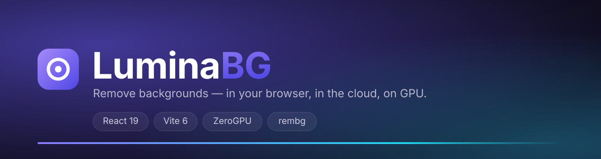

<div align="center">
  

  <br/>

  <b>Remove backgrounds with the right model for the job</b><br/>
  instant and private in your browser, sharpest in the cloud, most powerful on GPU.

  <br/><br/>

  <a href="https://image-background-remover-lake.vercel.app/"></a>
  
  
  
  

  <br/><br/>

  <a href="https://image-background-remover-lake.vercel.app/"><b>▶ Try LuminaBG</b></a>
</div>

---

## What is LuminaBG?

**LuminaBG is a hybrid background remover.** Most tools lock you into one engine — a slow paid API, or a weak local model. LuminaBG ships **seven**, spanning a zero-upload browser engine, a best-in-class cloud API, and state-of-the-art open-source models running on GPU. You pick the model per image, see speed/quality up front, compare the result side-by-side, and export a transparent PNG — or drop the cutout onto any background colour.

One clean interface. Three ways to run. No lock-in.

> **Built for real-world images** — optional alpha matting recovers fine hair and fur, and the strongest open-source model (BiRefNet) is one click away when edges matter.

---

## Why it's different

| | |
|---|---|
| 🔒 **Zero-upload privacy** | The Browser engine runs fully on your device via `@imgly/background-removal`. Your image never leaves the tab. |
| 🧩 **No vendor lock-in** | Mix a free local model, a paid cloud API, and open-source GPU models in the same session. |
| 🎯 **Built for hard edges** | Optional alpha matting (fg `240` / bg `10` / erode `10`) for hair, fur, and fine detail. |
| 🖼️ **Ship-ready output** | Transparent PNG, or composite onto 8 solid colours — rendered on a canvas at full resolution. |
| 💸 **Free by design** | Browser mode is unlimited and free; HF models run on ZeroGPU; `remove.bg` is entirely optional. |

---

## Features

- **Drag-and-drop upload** — JPEG, PNG, WebP, GIF up to 20 MB.
- **7 AI engines** — switch models per image from a live selector with speed & quality bars.
- **Before / after compare** — draggable slider plus Result and Original tabs.
- **Background presets** — transparent, plus white, black, gray, blue, green, red, yellow, purple.
- **Alpha matting toggle** — finer edges for hair and fur on supported models.
- **Dark / light theme** — remembers your choice across visits.
- **One-click PNG download** — transparent or composited, straight from the browser.
- **Privacy-first** — nothing is stored; the client-side engine uploads nothing at all.

---

## The model lineup

| Model | Engine | Runs on | Speed | Quality |
|---|---|:---|:---:|:---:|
| **Browser (Fast & Free)** | `@imgly/background-removal` (`isnet_quint8`) | Your device (WASM/ONNX) | 95 | 78 |
| **remove.bg API** | remove.bg cloud | Vercel serverless proxy | 90 | 100 |
| **U2-Net** | `rembg` | Hugging Face ZeroGPU | 85 | 72 |
| **U2-Net-P** | `rembg` | Hugging Face ZeroGPU | 95 | 60 |
| **ISNet** | `rembg` | Hugging Face ZeroGPU | 70 | 88 |
| **BiRefNet** | `rembg` | Hugging Face ZeroGPU | 50 | 96 |
| **Silueta** | `rembg` | Hugging Face ZeroGPU | 88 | 75 |

*Speed and quality are LuminaBG's own in-app scores — tuned for at-a-glance comparison, not benchmarks.*

---

## How it works

```
                 ┌────────────────────────────────────────────┐
                 │   Browser — React 19 + Vite (Vercel)         │
                 │   Model selector · compare slider · export   │
                 └───────────────┬──────────────────────────────┘
                                 │  pick a model
        ┌────────────────────────┼────────────────────────────┐
        ▼                        ▼                            ▼
┌────────────────┐    ┌────────────────────┐    ┌────────────────────────────┐
│ Browser engine │    │ Cloud engine        │    │ GPU engine                  │
│ @imgly/        │    │ /api/remove-        │    │ Gradio Space (ZeroGPU)      │
│ background-    │    │ background          │    │ /gradio_api/call/remove     │
│ removal        │    │ (Vercel serverless) │    │ rembg + onnxruntime         │
│ on-device,     │    │ → remove.bg         │    │ u2net · u2netp · isnet ·    │
│ no upload      │    │ needs API key       │    │ birefnet · silueta          │
└────────────────┘    └────────────────────┘    └────────────────────────────┘
```

- **Browser engine** — `@imgly/background-removal` runs an ONNX model in the tab. Free, instant, private.
- **Cloud engine** — a Vercel serverless function (`formidable` multipart, 20 MB cap) proxies to remove.bg and streams back a PNG.
- **GPU engine** — a Gradio Space exposes a single `remove` endpoint. The frontend submits the image, then reads the result from Gradio's SSE stream (`event: complete`) and converts it to a Blob.

---

## Quick start

**Requirements:** Node 18+ and npm.

```bash
git clone https://github.com/AMRITO-KUNDU/Image-Background-Remover.git
cd Image-Background-Remover

npm install          # installs the frontend workspace
npm run dev          # → http://localhost:5000
```

The **Browser engine works with zero configuration**. To unlock the cloud and GPU engines, add the environment variables below.

```bash
cp .env.example .env
```

---

## Environment variables

| Variable | Where | Required | Purpose |
|---|---|:---:|---|
| `VITE_HF_SPACE_URL` | Frontend | optional | Base URL of your Gradio Space, e.g. `https://your-space.hf.space` (no trailing slash). Unlocks the U2-Net / ISNet / BiRefNet / Silueta models. |
| `VITE_HF_TOKEN` | Frontend | optional | Hugging Face token for higher ZeroGPU quota. |
| `REMOVE_BG_API_KEY` | Vercel | optional | Enables the remove.bg cloud engine. |

> Without any of these, LuminaBG still runs — the free, private Browser engine is always available.

---

## Deploy

**Frontend (Vercel).** Set the project **Root Directory to `frontend`**. Add the env vars above, then deploy. The serverless remove.bg proxy lives at `api/remove-background.js`.

**Models (Hugging Face Space).** Create a Space with the **Gradio** SDK (ZeroGPU on a free account if available) and place `hf-space/app.py`, `hf-space/requirements.txt`, and `hf-space/README.md` at the Space root. Copy the Space URL into `VITE_HF_SPACE_URL`.

**Auto-sync (optional).** The workflow at `.github/workflows/sync-hf-space.yml` pushes `hf-space/` to your Space on every commit. Set the repo secret `HF_TOKEN` and the variables `HF_USERNAME` / `HF_SPACE_NAME`.

---

## Tech stack

**Frontend** — React 19 · Vite 6 · `@imgly/background-removal` · Material Icons Round · Inter / Outfit
**Serverless** — Node.js · `formidable` · Vercel Functions
**Models** — Gradio · `rembg` · `onnxruntime` · Pillow · Hugging Face ZeroGPU
**CI/CD** — GitHub Actions (HF Space sync) · Vercel

---

## Project structure

```
Image-Background-Remover/
├── frontend/                 # React app (Vercel Root Directory)
│   ├── api/                  # remove.bg serverless proxy
│   └── src/
│       ├── components/       # Header · ModelSelector · UploadZone · ResultPanel · Footer
│       ├── hooks/            # useBackgroundRemoval — one API, three engines
│       └── lib/              # clientSideRemover · serverApi · hfSpaceApi
├── hf-space/                 # Gradio Space (rembg models, ZeroGPU)
│   ├── app.py
│   └── requirements.txt
├── .github/workflows/        # sync-hf-space.yml
├── assets/                   # banner + brand assets
└── vercel.json
```

---

## Roadmap

- [ ] Batch / multi-image processing
- [ ] Additional export formats (WebP, JPEG with quality control)
- [ ] Wire the model marketplace to a live model catalogue
- [ ] Per-model presets and saved defaults

---

## Credits

Built by **[Amrito Kundu](https://github.com/AMRITO-KUNDU)**.
Background removal powered by **[rembg](https://github.com/danielgatis/rembg)**, **[@imgly/background-removal](https://github.com/imgly/background-removal-js)**, **[remove.bg](https://www.remove.bg/)**, and **Hugging Face Gradio / ZeroGPU**.

## License

Released under the **MIT License** — see [LICENSE](LICENSE).
